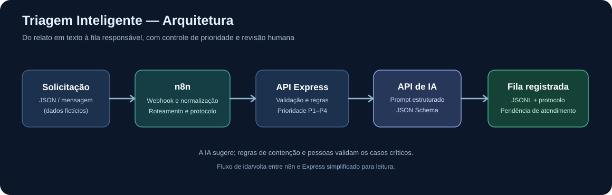
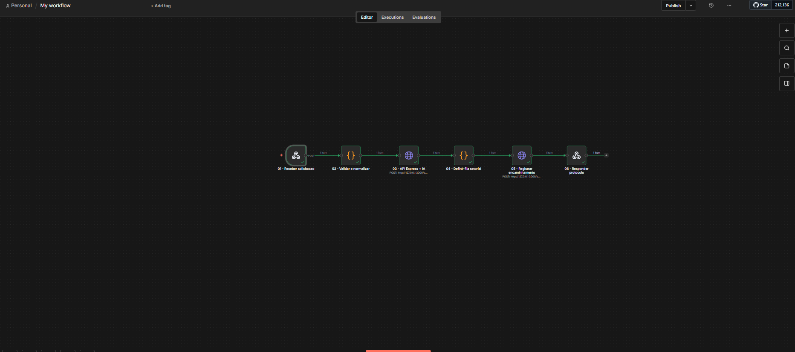
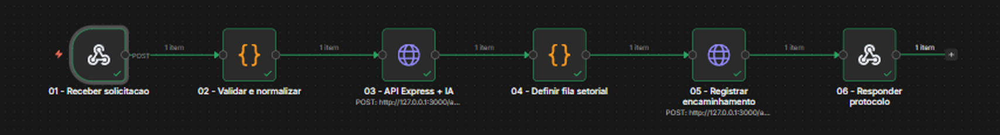
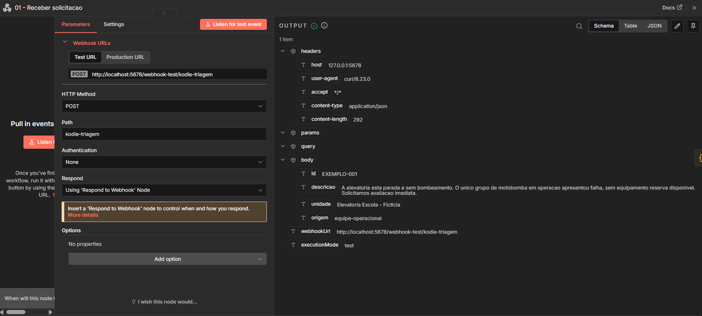
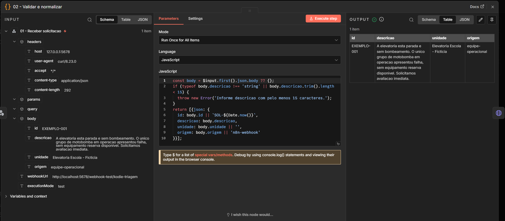
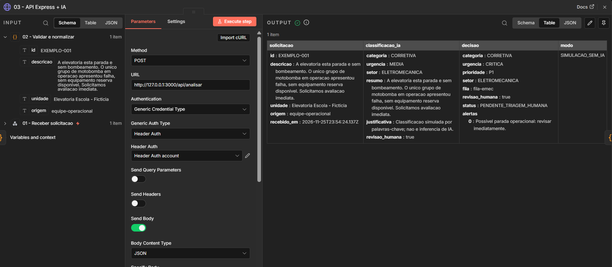
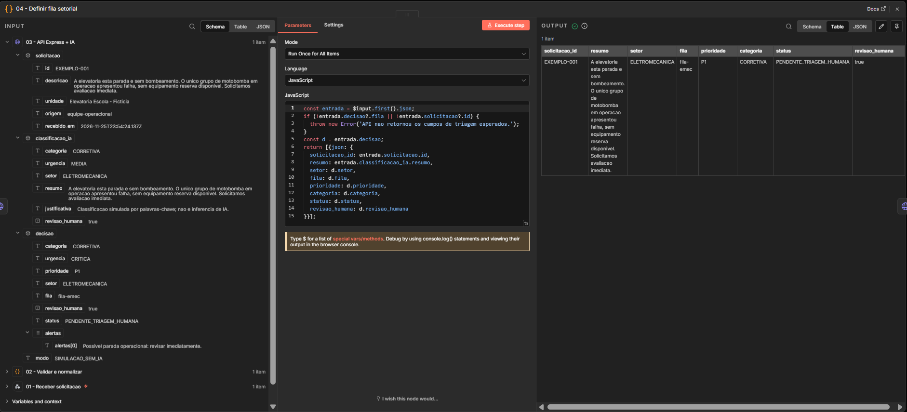
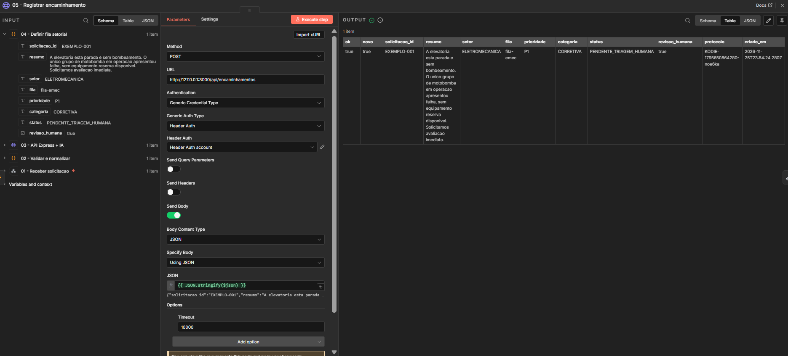
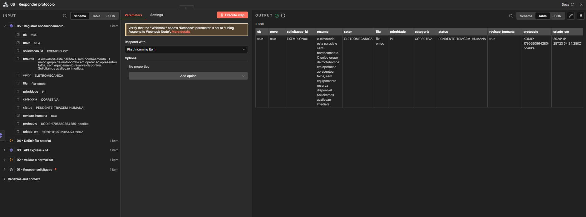

# KODIE | Triagem Inteligente de Solicitações de Manutenção

**Desafio Técnico: IA e Automação · Caso 4.3 — Organização de Tarefas**  
Node.js + Express + integração OpenAI **ou Gemini** + n8n · execução local sem Docker.

> **Situação atual (26/11/2026):** os 6 nodes do n8n foram demonstrados em `AI_MODE=mock`; o cliente Gemini foi implementado para testes com IA real e acrescentados testes automatizados com rede simulada. **Ainda falta executar uma chamada Gemini real e salvar as novas evidências**. A tentativa anterior com OpenAI retornou `HTTP 429`. A simulação não substitui IA real.
>
> **Escopo educacional:** todas as unidades, solicitações e mensagens de teste são fictícias. Nenhuma ordem SAP ou intervenção de campo é disparada.



## 1. Ideia e problema escolhido

Equipes de manutenção recebem solicitações por texto livre. Para tratá-las, é necessário ler o relato, identificar categoria, impacto, prioridade e setor, além de encaminhar as informações de forma padronizada. A triagem manual dificulta a rastreabilidade e pode atrasar a análise de problemas graves.

O **caso 4.3 — Organização de Tarefas** foi escolhido para demonstrar como uma API integrada à IA e ao n8n pode automatizar a primeira etapa do atendimento, sem substituir a decisão técnica humana.

## 2. Solução proposta e funcionamento

1. **Node 01 — Webhook:** recebe uma solicitação via HTTP `POST` com `id`, `descricao`, `unidade` e `origem`.
2. **Node 02 — Code (JS):** valida a descrição e normaliza os campos.
3. **Node 03 — HTTP Request:** envia a entrada para a API Express `POST /api/analisar`.
4. **API + IA:** com `AI_MODE=live` e `AI_PROVIDER=gemini`, solicita ao Gemini uma classificação estruturada; `AI_PROVIDER=openai` preserva a opção original com Responses API. Com `AI_MODE=mock`, usa exclusivamente um classificador determinístico de demonstração.
5. **Regras do back-end:** verificam riscos explícitos e elevam a prioridade quando há situações graves, como paralisação de bombeamento ou risco elétrico.
6. **Node 04 — Code (JS):** organiza `solicitacao_id`, `categoria`, `prioridade`, `fila`, `setor` e `revisao_humana`.
7. **Node 05 — HTTP Request:** chama `POST /api/encaminhamentos` para registrar o protocolo em uma fila demonstrativa JSONL.
8. **Node 06 — Respond to Webhook:** devolve o protocolo e o status da solicitação.

**Limite funcional:** encaminhar significa registrar na fila local; não são enviados e-mails ou mensagens externas, nem criadas ordens SAP. Decisões críticas exigem confirmação humana.

### Exemplo de entrada

```json
{
  "id": "EXEMPLO-001",
  "descricao": "A elevatoria esta parada e sem bombeamento. O unico grupo de motobomba em operacao apresentou falha, sem equipamento reserva disponivel. Solicitamos avaliacao imediata.",
  "unidade": "Elevatoria Escola - Ficticia",
  "origem": "equipe-operacional"
}
```

### Resultado observado no teste demonstrativo

| Campo | Resultado |
|:--|:--|
| Execução n8n | 6 de 6 nodes concluídos |
| HTTP do Webhook | 200 |
| Categoria | CORRETIVA |
| Prioridade final | P1 |
| Setor | ELETROMECANICA |
| Fila | fila-emec |
| Status | PENDENTE_TRIAGEM_HUMANA |
| Revisão humana | true |
| ID | EXEMPLO-001 |
| Modo do classificador | SIMULACAO_SEM_IA |

A prioridade P1 veio das **regras determinísticas de segurança da API**, mesmo com o classificador simulado retornando urgência média. Isto é evidenciado nos prints abaixo, e não deve ser apresentado como inferência de IA.

## 3. Tecnologias utilizadas

| Camada | Tecnologia | Responsabilidade |
|:--|:--|:--|
| Back-end | Node.js 22+, Express 5 | Endpoints, autenticação, validação e registro |
| IA real (pendente de validação fim a fim) | Google Gemini API ou OpenAI Responses API | Análise semântica com resposta JSON estruturada |
| Prompt | `src/prompt.js` | Instruções e JSON Schema |
| Automação | n8n 2.8.4 (local) | Webhook, transforms, HTTP e resposta |
| Registro | JSON Lines (JSONL) | Persistência simples, idempotência por ID |
| Testes | `node:test` | 12 verificações automatizadas |
| Versionamento | Git/GitHub, GitHub Actions | Código e testes CI |

## 4. Como executar sem Docker (Windows + Git Bash)

Requisitos: Node.js 22+, npm e Git Bash. Na pasta do projeto:

```bash
npm install
cp .env.example .env
```

Abra `.env` e defina `API_ACCESS_KEY` com um segredo **longo e aleatório**, mantendo `AI_MODE=mock` para o teste local sem consumo de créditos. **Não inclua** `.env`, prints de segredos ou `data/*.jsonl` no GitHub.

**Terminal 1 — API:**

```bash
node --env-file=.env src/server.js
```

Verifique `http://127.0.0.1:3000/health` — deve retornar `{"status":"ok","ia":"mock"}`.

**Terminal 2 — n8n:**

```bash
npx n8n@2
```

Abra `http://127.0.0.1:5678`, crie a conta local, se solicitado, e importe `n8n/fluxo_triagem_kodie.json` em **Import from File**. Esta é a versão adaptada para **execução local sem Docker**.

**Configuração importante após importar:** os nodes 03 e 05 usam `http://127.0.0.1:3000`. Em cada um, selecione **Generic Credential Type → Header Auth** e crie/selecione uma credencial com o header **`x-api-key`** cujo valor deve ser idêntico ao `API_ACCESS_KEY` do seu `.env`. O JSON exportado **não contém credenciais**, por segurança. Mantenha o Body `Using JSON` com `{{ JSON.stringify($json) }}`. Não duplique o header no painel Send Headers.

**Terminal 3 — teste do workflow:**

1. No node 01, clique em **Listen for test event**.
2. Na raiz do projeto, execute:

```bash
sh scripts/teste-n8n.sh
```

Ou:

```bash
curl -i -X POST http://127.0.0.1:5678/webhook-test/kodie-triagem \
  -H 'Content-Type: application/json' \
  --data-binary @examples/solicitacao-critica.json
```

O n8n deverá executar os seis nodes e retornar um JSON contendo `ok`, `novo`, `protocolo`, `prioridade`, `fila` e `status`. Se repetir exatamente o mesmo ID, `novo` pode ser `false`: isso indica proteção contra duplicidade e é comportamento esperado.

### Testar a API diretamente

```bash
export API_ACCESS_KEY="$(sed -n 's/^API_ACCESS_KEY=//p' .env | tr -d '\r')"
sh scripts/teste-endpoint.sh
```

### Ativar a integração real com IA — pendente

**Caminho recomendado (Gemini):** siga [o guia passo a passo](docs/GUIA_GEMINI.md). Configure `AI_MODE=live`, `AI_PROVIDER=gemini`, `GEMINI_API_KEY` e `GEMINI_MODEL=gemini-3.5-flash-lite`. Não publique chaves. A API identifica o provedor no endpoint `/health`. A faixa gratuita do Gemini depende de elegibilidade, limite e disponibilidade na sua conta; o conteúdo enviado pode ser usado para melhoria de produtos do provedor. Use somente exemplos fictícios.

**Alternativa original (OpenAI):**

1. Configure **uma chave de API válida, com quota disponível**, em `OPENAI_API_KEY` no seu `.env` e selecione `AI_PROVIDER=openai`.
2. Altere `AI_MODE=live`, salve e reinicie a API.
3. Execute o endpoint `POST /api/analisar` e confirme que o resultado mostra `"modo": "IA_REAL"`.
4. Execute novamente o webhook n8n e substitua as capturas de classificação simulada pelas evidências de IA real.

**Situação verificada:** a autenticação com `GET /v1/models` foi bem-sucedida (`HTTP 200`), mas a requisição à Responses API retornou `HTTP 429`. Isso pode indicar limite de solicitações ou quota/faturamento; é necessário conferir a mensagem específica e as configurações da conta. A etapa real **não foi comprovada** e não deve ser assinalada como concluída no envio à KODIE.

## 5. Evidências visuais da execução local (capturas originais)

As imagens foram capturadas durante o teste real do **n8n + API Express em modo mock**, em 25/11/2026. Mostram configurações dos nodes e dados fictícios. **Não demonstram uma chamada concluída à OpenAI.** [Relatório ilustrado em PDF](docs/RELATORIO_EVIDENCIAS_KODIE.pdf).

### Fluxo completo e execução dos 6 nodes



*Figura 1 — Workflow com entrada, validação, API, fila, persistência e retorno. Os seis nodes aparecem com sucesso de execução.*



*Figura 1a — Recorte ampliado do próprio print (sem alteração dos resultados).* 

### Entrada do Webhook (node 01)



*Figura 2 — Endpoint POST `/webhook-test/kodie-triagem`, modo resposta por node dedicado e JSON fictício recebido.*

### Validação e normalização (node 02)



*Figura 3 — Código JavaScript que normaliza `id`, `descricao`, `unidade` e `origem`; saída tabular.*

### Classificação via API Express (node 03)



*Figura 4 — Requisição POST a `127.0.0.1:3000/api/analisar`, resultado estruturado. A coluna `modo` indica `SIMULACAO_SEM_IA`.*

### Definição de fila (node 04)



*Figura 5 — Conversão de decisão em registro padronizado, incluindo prioridade, fila e revisão humana.*

### Registro do encaminhamento (node 05)



*Figura 6 — Envio da decisão para a API e retorno com identificador e protocolo persistido.*

### Resposta final ao solicitante (node 06)



*Figura 7 — Node Respond to Webhook devolve o primeiro item recebido, contendo `protocolo`, `prioridade` e `status`.*

Veja o [índice completo das capturas e de seus significados](docs/evidencias/README.md).

## 6. Testes e validação

```bash
npm test
```

**Teste local realizado em 25/11/2026:** 12 testes, 12 aprovados, 0 falhas, conforme saída compartilhada durante a montagem. A suíte contempla validação, regras de criticidade, registro sem duplicidade, resposta inválida de IA, teste do cliente HTTP com rede simulada e integridade estrutural do workflow. **Não é teste de conexão real com a OpenAI.**

[Registro de validação e pendências](docs/VALIDACAO.md).

## 7. Estrutura do repositório

```text
kodie-triagem-inteligente/
├── src/                # API Express, cliente IA, regras, prompt
├── n8n/                # JSON do fluxo local e opção original Docker
├── tests/              # testes Node
├── examples/           # solicitações fictícias
├── scripts/            # testes via curl
├── docs/
│   ├── evidencias/     # prints reais (modo mock) e índice
│   ├── RELATORIO_EVIDENCIAS_KODIE.pdf
│   ├── VALIDACAO.md
│   └── arquitetura.svg
├── .github/workflows/   # CI para testes
├── .env.example        # placeholders, SEM segredos
├── .gitignore
├── package.json
└── README.md
```

## 8. Segurança e limitações

- Nunca publique `.env`, chaves OpenAI, credenciais n8n, arquivos JSONL de atendimento ou dados reais de clientes/equipamentos.
- `Header Auth` protege a comunicação dos nodes n8n com a API local. O Webhook está **sem autenticação** apenas porque os testes são locais; **não o exponha na internet nessa configuração**.
- Não há front-end, integração SAP, notificação externa ou banco corporativo; são evoluções possíveis, fora do MVP.
- `AI_MODE=mock` é determinístico e não constitui IA. A etapa exigida de **modelo real** só estará comprovada depois de teste live bem-sucedido.
- A IA pode errar e as regras não abrangem todos os riscos: decisões críticas exigem validação profissional.

## 9. Atualizar o GitHub e enviar à KODIE

**Repositório publicado:** https://github.com/talita-olv/kodie-triagem-inteligente

1. Use o repositório existente, sem criar outro.
2. Confira `git status` e certifique-se de que `.env`, `node_modules` e `data/*.jsonl` não serão incluídos.
3. Na pasta do projeto, execute os comandos abaixo (troque `SEU_USUARIO`):

```bash
git pull --ff-only
git add .
git status
git commit -m "Evidencias da IA real Gemini"
git push origin main
```

4. Confira se o `README.md`, `docs/evidencias/`, `n8n/fluxo_triagem_kodie.json` e os testes estão no GitHub. A aba **Actions** executa a suíte automatizada, conforme as permissões do repositório.
5. **Antes da avaliação final, conclua a integração real com IA** ou informe explicitamente a pendência. Consulte também [ENTREGA_KODIE.md](ENTREGA_KODIE.md) para o texto de submissão.

**Documentação do desafio:** o objetivo é demonstrar integração IA + API + n8n, organização/validação de dados e rastreabilidade. Uma execução mock, isoladamente, não satisfaz a exigência de IA funcional.

## 10. Atualização: provedor Gemini

- **Sem Docker:** o fluxo n8n permanece igual, com os mesmos seis nodes e URLs `127.0.0.1:3000`.
- **Troca controlada:** `AI_MODE=live` e `AI_PROVIDER=gemini` usam uma chamada real ao modelo configurado; `AI_MODE=mock` mantém a demonstração antiga; `AI_PROVIDER=openai` conserva a integração original.
- **Segurança:** nenhuma chave foi publicada no GitHub. A nova chave deve existir apenas no seu `.env` local. Não enviar dados reais de clientes/unidades ao nível gratuito.
- **Critério de conclusão:** o resultado `"modo":"IA_REAL"` e o fluxo n8n completo precisam ser observados na sua máquina. **Não afirmamos ter executado Gemini real nesta entrega.**

Consulte [docs/GUIA_GEMINI.md](docs/GUIA_GEMINI.md) para os comandos exatos de Git Bash e atualização das evidências.
